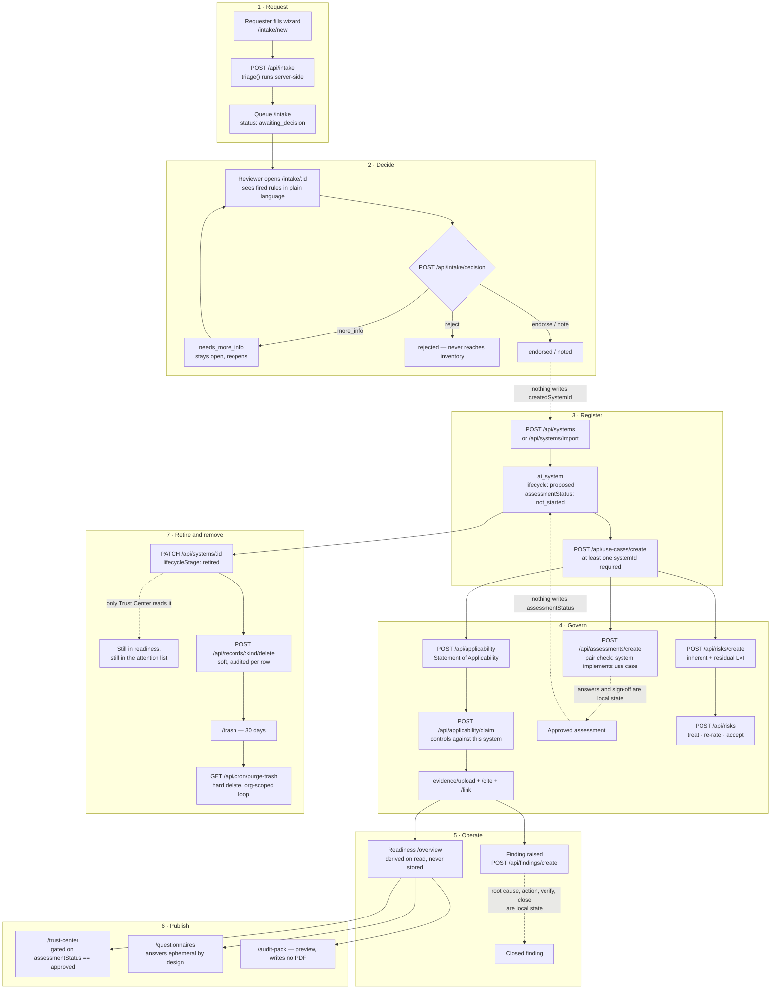

> Historical design review of the original demo snapshot. The public cleanup
> fixes assessment oversight defaults and current dates, removes automatic
> migrations/private-domain routing, and labels incomplete workflows. Consult
> [current limitations](known-limitations.md) and [deployment](deployment.md)
> for current behaviour; the gap analysis below is not an unqualified current-state claim.

# The AI lifecycle, end to end

What actually happens to an AI system in Forseti, from the moment somebody wants
one to the moment its record is purged — who does each step, which screen they
do it on, which route persists it, and which steps the product *shows* but does
not yet write down.

This file is the workflow companion to [`architecture.md`](architecture.md)
(how the tenant boundary and the derived numbers work) and to the screen-level
record in [`src/app/(app)/_ams/README.md`](../src/app/%28app%29/_ams/README.md).
`CLAUDE.md` holds the laws; this holds the order they apply in.

**Read the Persists column.** Forseti is part shipped product and part approved
mockup, and the two are not visually distinguishable in the app. A stage marked
*local state* renders, validates, gates on the right permission and then forgets
everything on refresh. Anyone planning work from this document needs that column
more than any other.

---

## 1. Which comes first — inventory or use case?

**A system must exist before a use case can.** This is enforced, not conventional:

- `USE_CASE_CREATE_SCHEMA` requires `systemIds` with `.min(1, "A use case is
  implemented by at least one system.")` — `src/lib/ams/use-case-create.ts:55`.
- `POST /api/use-cases/unlink` refuses to remove the last system, because the
  join cannot express a minimum and a use case with no systems is silently
  dropped by `readWorkspace` with no tombstone.
- `POST /api/use-cases` (the edit route) cannot create the relation at all —
  `EDITABLE` is scalars only (`src/app/api/use-cases/route.ts:45`).

So the enforced order is **system → use case**, and everything downstream
(assessments, tier resolution, coverage, Trust Center disclosure) resolves
against the *pairing* rather than either object alone.

The nav suggests a different order — Discover reads `AI Inventory · Use cases ·
Intake & triage` (`src/components/sidebar.tsx:47-49`) — because it is grouped by
frequency of use, not by first run. **Intake is the narrative front door but not
the data one:** a decided request creates nothing (see §4.3).

### The three-object spine

| Object | Answers | Own risk tier? | Table |
|---|---|---|---|
| `AISystem` | *What tool do we run?* | yes, `riskTier` | `ai_system` |
| `AIUseCase` | *What job is it doing?* | yes, `riskTier` (baseline) | `ai_use_case` |
| the pairing | *How risky is **this tool** doing **that job**?* | yes, nullable override | `ai_use_case_system` |

Resolve a pairing through `effectiveTier(useCaseId, systemId)` /
`effectiveOversight(...)` (`src/lib/ams/workspace.ts:215,223`). A null override
means the use case's baseline stands. Reading the raw field where a system is in
scope is the commonest way to get a wrong answer here — and there is one live
instance of it, see §5.1.

---

## 2. End to end

Solid arrows are handoffs a route performs. **Dashed arrows are handoffs the UI
promises and no code performs** — a human retypes the data, or it is lost.

---

## 3. Who may do what

Five immutable roles (`src/lib/permissions.ts:375-379`). The statements that
shape the workflow:

| Stage | Statement | platform_admin | governance_lead | system_owner | reviewer | auditor |
|---|---|:-:|:-:|:-:|:-:|:-:|
| Submit a request | `intake: ["create"]` | ✓ | ✓ | ✓ | — | — |
| Decide a request | `intake: ["update"]` | ✓ | ✓ | ✓ | — | — |
| Register / edit a system | `system: ["create","update"]` | ✓ | ✓ | ✓ | — | — |
| Declare a use case | `useCase: ["create","update"]` | ✓ | ✓ | ✓ | — | — |
| Set framework scope | `framework: ["update"]` | ✓ | ✓ | — | — | — |
| Answer a control or assessment field | `answer: ["update"]` | ✓ | ✓ | ✓ | — | — |
| Upload / cite evidence | `evidence: ["create"]` | ✓ | ✓ | ✓ | — | — |
| Work the risk register | `risk: ["create","update"]` | ✓ | ✓ | ✓ | — | — |
| Raise / remediate a finding | `finding: ["create","update"]` | ✓ | ✓ | ✓ | — | — |
| **Verify** a finding | `finding: ["verify"]` | ✓ | ✓ | — | ✓ | — |
| **Endorse / reject** an assessment | `signoff: ["approve","reject"]` | ✓ | ✓ | — | ✓ | — |
| **Approve** a policy | `policy: ["approve"]` | ✓ | ✓ | — | ✓ | — |
| Assign a reviewer | `review: ["assign"]` | ✓ | ✓ | — | — | — |
| Restore from trash | `role: ["update"]` | ✓ | — | — | — | — |
| Export any register | `*: ["export"]` | ✓ | ✓ | ✓ | ✓ | ✓ |

The separation the management system leans on: **a system owner cannot approve
or verify their own work**, and a reviewer cannot author. Enforced twice — by the
role definitions, and by `FORBIDDEN_GRANTS` (`src/lib/permissions.ts:552`), which
stops a tenant editing the separation away in `/settings/roles`.

Two consequences worth naming:

- **`framework: ["update"]` is deliberately withheld from `system_owner`.** Scope
  is the governance lead's decision, so the Controls tab's claim button is
  *visibly refused* rather than hidden.
- **The three approval statements — `signoff`, `finding: verify`,
  `policy: approve` — are enforced by no route.** They exist and are correct; the
  screens they belong to hold local state. See §5.1, G6.

---

## 4. The lifecycle, stage by stage

Legend for **Persists**: **DB** = a route writes and audits · **local** = React
state, gone on refresh · **derived** = computed on read, never stored.

### 4.1 Request

| | |
|---|---|
| Screen | `/intake/new` — five steps, step 3 chosen by `origin` |
| Actor | anyone holding `intake: ["create"]` |
| Route | `POST /api/intake` |
| Writes | `ai_intake_request` · `status: awaiting_decision` · `reviewerId: ""` |
| Audited | yes — per sub-field and per origin answer, never as one `jsonb` blob |
| Persists | **DB** |

`origin` selects a question set, not a screen (`QUESTION_SETS` in
`src/lib/ams/fixtures/intake.ts`). Procured SaaS asks about the contract, the DPA
and whether the vendor trains on your data; an API integration asks about
logging, retention, redaction and egress; an internal model asks about training
data, rights, evaluation and who may retrain.

`reviewType` is **computed server-side** by `triage()` over the cleaned
submission — the wizard sends answers and nothing else. A client that could name
its own review type could submit a request that arrives pre-agreed.

A submission stays editable before a decision *and after one*, through
`PATCH /api/intake/[requestId]`; the decision never does. Changing `origin`
clears `originAnswers`, and the patch route drops any answer the current question
set does not ask for — an orphaned answer would go on firing a triage rule nobody
was asked.

### 4.2 Triage

Eleven rules, written as `Predicate` data rather than closures so the review
screen can print the ones that fired in plain language. Eight imply
`endorsement`, three imply `noting`; any single escalating rule lifts the whole
result, because these are floors and not a score.

**Escalating:** special-category or health data · informs decisions about people ·
customer-facing GenAI · internal build · personal data with no signed DPA · vendor
may train on our data · unbounded retention · unredacted payload.
**Noting:** personal data · customer-facing · click-through or trial terms.

**Nothing about the recommendation is stored as a gate.** The decision route
re-runs `triage(existing.submission)` and measures the departure against *that*,
not against the stored `reviewType` — because the review screen has always
printed the live recommendation as *the* recommendation
(`src/app/api/intake/decision/route.ts:126`). The stored field is kept for the
export and the auditor: it is what the rules said on the day.

### 4.3 Decision

| | |
|---|---|
| Screen | `/intake/[requestId]` |
| Actor | `intake: ["update"]` |
| Route | `POST /api/intake/decision` |
| Writes | `status`, `reviewType`, `overrideJustification`, `decision`, `decidedById`, `decidedAt`, `comments` |
| Persists | **DB** |

Four outcomes. Three are **write-once** and 409 on a second attempt; `more_info`
is the exception and is not a hole in the rule — it asks a question rather than
answering one, leaves the request `open: true`, and the queue goes on counting
days waited. `isSettled()` (`src/lib/ams/intake-create.ts`) is the single
predicate the route and the screen both read, so a screen can never offer a
decision the route refuses.

Departing from the recommendation demands a written justification, **in the
route** — the same shape as the rule that accepting a residual risk needs a
reason. After a decision the record grows only by
`POST /api/intake/[requestId]/notes`, which is append-only by design: no PATCH,
no DELETE, no `updatedAt`, a plain insert rather than an upsert. Correcting a
note means adding another.

> ⚠️ **The decision creates nothing.** `createdSystemId` is written by the seed
> and the fixtures only — no route sets it. The `endorse` blurb says *"An impact
> assessment is created and assigned to the owner"* and `note` says *"Registered
> in the inventory and scheduled for review"* (`DECISIONS` in
> `src/lib/ams/fixtures/intake.ts`). Neither happens. Somebody retypes the
> submission into the register form. See §5.1, G2.

### 4.4 Register the system

| | |
|---|---|
| Screen | `/inventory` — Register dialog, or Import |
| Actor | `system: ["create"]` |
| Routes | `POST /api/systems` · `POST /api/systems/import/parse` → `/import` |
| Writes | `ai_system` |
| Persists | **DB** |

The body is the eight answers the form collects, never an `AISystem`: lifecycle,
risk tier and assessment status are decided server-side, so nobody can register a
system that arrives already approved (`src/lib/ams/system-create.ts:103`). Ids
are minted server-side by `ams/record-id.ts` — every store write upserts, so a
caller-chosen id is a silent overwrite.

Import plans, validates, then applies. A file over 500 rows or 60 columns is
**refused by name and count**, never truncated. There is no transaction:
`saveAiSystem` writes and audits per row, and the response reports each row
rather than implying an all-or-nothing the store does not provide.

### 4.5 Declare the use cases

| | |
|---|---|
| Screen | `/use-cases`, or the system profile's Use Cases tab |
| Actor | `useCase: ["create"]` |
| Routes | `POST /api/use-cases/create` · `/link` · `/unlink` · `POST /api/use-cases` (edit) |
| Writes | `ai_use_case` + `ai_use_case_system` (PK `(orgId, useCaseId, systemId)`) |
| Persists | **DB** |

This is the stage most organisations skip and the one that carries the regulatory
weight. Two answers do most of the work — `facesCustomers` and
`informsDecisionsAboutPeople` — and they are what the assessment template's
conditional sections key off.

Where one pairing genuinely differs from the purpose's own answer, record it as a
**sparse override** on the link row rather than splitting the use case.
`saveUseCase` replaces links wholesale, so a write that does not carry
`systemOverrides` through discards every pair-level judgement — the edit route
carries them because it spreads `{...current}` from a hydrated read
(`src/app/api/use-cases/route.ts:101`).

### 4.6 Scope the framework

| | |
|---|---|
| Screen | `/frameworks/[frameworkId]` — Statement of Applicability |
| Actor | applicability needs `framework: ["update"]`; everything else `answer: ["update"]` |
| Route | `POST /api/applicability` (read · merge · write) |
| Persists | **DB** |

Two statements on one route, deliberately: the working loop (status, owner,
policy, justification) is the system owner's, and **scope is not**. An exclusion
whose merged row carries under `MIN_JUSTIFICATION` characters of prose is
refused — the justification cell commits on blur, and marking a control No/N/A is
held client-side until a justification exists and then sent as one patch.

Claiming controls against a system (`POST /api/applicability/claim`) is
**additive only**: the route unions, because `saveApplicability` rewrites the
whole set and a caller sending the desired total would silently un-claim another
system's controls. A control the SoA marks `no`/`na` is refused.

### 4.7 Evidence

| | |
|---|---|
| Screen | `/evidence`, the SoA control row, the profile's Evidence tab |
| Actor | `evidence: ["create"]` to upload/link/cite; `["delete"]` to unlink/uncite |
| Routes | `POST /api/records/evidence/upload` · `/link` · `/unlink` · `/cite` · `/uncite` |
| Persists | **DB** — except `verificationState`, below |

Hardening sequence, in order and not negotiable: `sniff` (magic bytes) →
`zip-guard` → `extract` (timeout and cap) → `pdf`. Text is extracted on ingest
and the raw bytes are discarded. A scan with no text is accepted, not refused.

**The empty set means opposite things on the two joins, and it is load-bearing.**
Empty `linkedSystemIds` means *every* system — so unlinking a document's last
system **widens** its reach, and the dialog warns. Empty `appliesToSystemIds` on
applicability means *no* systems — so unclaiming a control's last system simply
narrows it. Empty `linkedControlIds` is the plain third case: the document cites
nothing, and nothing reads that as "every control".

> ⚠️ **Uploaded evidence is `unverified` and nothing can change that.**
> `evidence-upload.ts:148` hardcodes it; the `evidence` resource has no `update`
> statement on any role; there is no verify route; and `evidence-record.tsx:35`
> holds the control in `useState`. `isUsableEvidence()` requires
> `verificationState === "verified"` (`readiness.ts:35`) and `isReady()` requires
> usable evidence. See §5.1, G3.

### 4.8 Impact assessment

| | |
|---|---|
| Screen | `/assessments/[assessmentId]` |
| Actor | `assessment: ["create"]`, then `answer: ["update"]` to fill it in |
| Routes | `POST /api/assessments/create` — **and that is all** |
| Persists | create: **DB**. Answers: **local**, except through `/api/suggestions`. Sign-off: **local**. |

Creating refuses a `useCaseId` the system does not implement — the pair check is
in the route, because `ai_assessment.use_case_id` has no foreign key and the
dialog's scoped picker is not a gate.

The template (`fixtures/assessment-template.ts`) is twelve sections: profile,
intended and unintended uses, stakeholders, benefits, potential harms, human
oversight, fairness and adverse impact, technology readiness, sensitive uses,
data requirements, known limitations, mitigations and residual position.
Section-level `showIf` is the mechanism that matters — answering *"informs
decisions about individual people"* with yes reveals the whole fairness section,
not one extra field. Completion counts only what is currently visible; a hidden
section's required fields are not outstanding work.

The rule with teeth: changing a **material** field changes which sections the
document contains, so any review already given resets — and the reset is written
as its own audit event, so an auditor asking why a signature disappeared can find
the answer without inferring it (`ai-store.ts:2140`). Non-material edits keep
signatures intact, because resetting an approval over a typo teaches owners not
to fix typos.

> ⚠️ **Typing an answer does not save it.** `saveAssessmentAnswers` exists, is
> correct, and has exactly one caller: `POST /api/suggestions`, when somebody
> accepts an AI-drafted field (`src/app/api/suggestions/route.ts:229`). There is
> no `PATCH /api/assessments/:id`. The renderer holds `answers` and `signOff` in
> `useState` (`assessment-renderer.tsx:58,61`).

### 4.9 Sign-off

Three stages — `owner_submit` → `governance_endorse` → `approver_approve` — with
`ai_review_assignment` recording **who should** review each stage and `signOff[]`
recording **where the chain has got to**. A split, not a duplicate: one names an
account, the other an `ai_person`, and `ai_account_person` maps between them.

Assigning is `review: ["assign"]` and sits with the governance lead, never the
reviewer: a reviewer who appoints their own reviewer has emptied the approval of
meaning, and the resulting record looks exactly like a properly assigned one.
Legal, Security and Exec sponsors are `ai_review_assignment` rows, never custom
database roles.

| | Persists |
|---|---|
| `POST /api/review-assignments` (who reviews) | **DB** |
| Advancing / sending back / withdrawing the chain | **local** |

### 4.10 Risks

| | |
|---|---|
| Screen | `/risks`, `/risks/[riskId]`, the profile's Risks tab |
| Actor | `risk: ["create"]` / `["update"]` |
| Routes | `POST /api/risks/create` · `POST /api/risks` · `/file` · `/unfile` |
| Persists | **DB** — the whole record |

The best-persisted screen in the product. Inherent and residual are each
likelihood × impact on 1–5, banded coarsely into three (`risk-scale.ts`) because
the difference between 11 and 12 is noise.

Four rules that are enforced rather than conventional:

1. **Ratings are required, never defaulted** — defaulting produces a register of
   1×1 entries that look assessed and sort to the bottom, exactly where nobody
   will find them again.
2. **A create route cannot land an accepted risk.** `acceptedById` and
   `acceptedAt` are forced null however the form is filled in.
3. **Accepting demands a written reason and a named person** from a picker —
   `acting-person.ts` forbids inferring a person from an account, and an
   acceptance nobody can be held to is not an acceptance.
4. **Re-rating voids the acceptance, in the store**, so the rule holds however the
   row arrives. Moving the status away from accepted does not void it: the number
   that was accepted has not changed.

A risk naming a use case must also name a system, and the pair must exist: a risk
about a purpose is a risk about that purpose *on a tool*. Filing an org-level risk
onto a system refuses a risk that already names one — filing is not transferring.
Unfiling clears `useCaseId` with `systemId`, because the half that survived alone
would be a claim nobody made.

### 4.11 Findings

| | |
|---|---|
| Screen | `/findings/[findingId]` |
| Actor | `finding: ["create"]`, then `["update"]`; verification is `["verify"]` |
| Routes | `POST /api/findings/create` · `/file` · `/unfile` |
| Persists | create/file/unfile: **DB**. Root cause, corrective action, verification, closure: **local**. |

A finding is distinct from a risk: a risk is something that might happen, a
finding is something already wrong. They close differently, and `canClose()`
encodes it — root cause, corrective action, and a **dated verification by
somebody other than the owner**, or the button stays down and names which of the
four is missing. A fix checked by the person who made it is a self-assessment,
and closed findings are the first thing an external auditor samples.

`FindingSource` is a first-class field because the mix is a maturity signal in its
own right: a register where everything came from an external auditor is a
management system that never finds its own problems.

`ai_finding_risk` models three relationships — `revealed`, `materialised`,
`undermines` — and `undermines` is the one worth having: a residual rating is a
claim that certain controls work, and an open finding against one of those
controls is direct evidence against the number.

> ⚠️ There is **no `/api/findings/route.ts`** — no edit route at all, so the four
> fields `canClose()` gates on are `useState` in `finding-record.tsx`. And
> `saveFindingRiskLink` exists in the store with no route and no UI that writes
> one; `risk-record.tsx:229` reads them, and the seed is the only writer.

### 4.12 Publish

| Surface | What it is | Persists |
|---|---|---|
| `/trust-center` | Dual-audience posture. The boundary is a property of the data — every entry declares its `audience`, the internal view *marks* what a customer would not see, and the external view states how much is hidden rather than quietly dropping it. | derived |
| `/questionnaires` | Inbound security questionnaires, answered by the copilot against controls, policies and evidence. Answers are **ephemeral by design** — never persisted, so the same question next quarter recomputes confidence against evidence that may have lapsed since. | derived |
| `/audit-pack` | Preview only; writes no PDF. | preview |

Trust Center rules worth knowing before changing anything there:

- A use case's name publishes only when **every** system implementing it is
  shareable. A shared purpose must not leak past a withheld system through an
  approved sibling.
- A **retired** system does not gate that disclosure — it has no entry to be
  inferred from, and letting one veto would hide a purpose forever with nothing
  on screen explaining why.
- Aggregations over a system's purposes: **maximum** tier (scoping attaches to
  intended purpose, so an average would let ordinary uses dilute a high-risk
  one), **count** of governed purposes, and **conjunction** for
  `everyUseCaseAssessed`. `highestTier` is null rather than "minimal" when
  nothing is recorded — unexamined is not low risk.
- Those three render **internal only**. Publishing them is a decision about what
  the organisation tells customers, not a side effect of the model learning to
  count.
- **The readiness percentage is internal.** A number without its definition
  invites comparison against somebody else's number computed a different way,
  and ours is deliberately strict.

The published oversight line is the **weakest** arrangement across a system's use
cases, with `oversightBasis` saying so beside it. An unrecognised `oversightLevel`
counts as the weakest, never the strongest.

### 4.13 Maintain

Nothing here runs on a schedule except the purge. Maintenance is a set of derived
signals on `/overview` that a human is expected to act on.

| Signal | Computed by | Trigger |
|---|---|---|
| Ungoverned system | `attentionRequired` | no control claimed against it |
| High risk, no approved assessment | `attentionRequired` | `riskTier === "high"` and no assessment `status === "approved"` |
| Expired or expiring evidence | `evidencePosture` | `expiresAt` past, or state `expired` |
| Evidence blast radius | `evidenceDependants` | which controls rest on this document **alone** |
| Overdue system review | `isOverdue(nextReviewDate)` | a date somebody typed |

`nextReviewDate` is a plain editable field on the profile
(`system-profile.tsx:1078`). Nothing sets it on a cadence, nothing recalculates it
after a review, and no job notifies anybody it has passed.

**Every figure is derived on read.** A document expiring moves the headline
without anyone editing a number, which is the whole argument for storing no
scores. The definition of *ready* is deliberately strict — applicable **and**
implemented **and** carrying evidence that is verified and current — and the gap
between "implemented" and "ready" is the most useful number in the product: the
distance between what an organisation believes about itself and what it could
prove on the day.

### 4.14 Retire

| | |
|---|---|
| Screen | system profile → Overview tab → Lifecycle stage |
| Actor | `system: ["update"]` |
| Route | `PATCH /api/systems/[systemId]` |
| Persists | **DB** |

`LifecycleStage` runs `proposed → poc → pilot → production → deprecated →
retired`. A use case has its own separate status (`active`, `piloting`,
`proposed`, `retired`), because a production system routinely carries a proposed
use case and a retired use case rarely retires the tool it ran on.

> ⚠️ **Retirement is a label with exactly one consumer.** The only place in
> `src/lib/` that reads it is `trust-center.ts:127`
> (`ws.systems.filter(s => s.lifecycleStage !== "retired")`). `readiness.ts` never
> filters on lifecycle at all — a retired system still counts in `systemPosture`
> totals and the by-risk breakdown, still generates "Ungoverned system" and "no
> approved assessment" attention items, and still shows an overdue review date.
> Retiring a system does not touch its use cases, its claimed controls, its open
> risks or its open findings.

### 4.15 Remove and purge

| | |
|---|---|
| Screen | any register's tick boxes; `/trash` |
| Actor | `<kind>: ["delete"]` to delete; `role: ["update"]` to view or restore |
| Routes | `POST /api/records/[kind]/delete` · `/restore` · `GET /api/cron/purge-trash` |
| Persists | **DB** |

All eight registers soft-delete and every read filters `deleted_at IS NULL`.
Destructive UI confirms by **naming** every record it will remove, never by
counting them. The retention window (30 days) lives once in `ams/trash.ts` and is
never restated in a screen or a query.

Restoring is not an edit: it never resets a sign-off chain. Restoring a system
automatically restores visibility of its dependants via `readWorkspace`.

A purge is org-scoped and looped per tenant — never one global
`DELETE ... WHERE deleted_at <`. It hard-deletes use cases only when their
**last** system is purged, nulls `ai_risk.use_case_id` and
`ai_assessment.use_case_id` first (neither has a foreign key into `ai_use_case`),
and clears the rows nothing cascades from: questionnaire questions and assessment
review assignments.

A use case survives while **any** of its systems does — `readWorkspace` strips the
dead system from `systemIds` rather than dropping the row, exactly as it does for
applicability claims and evidence links.

---

## 5. Conflicts and gaps

Triaged into three buckets. The third bucket is **not** a to-do list — those are
decisions the codebase already argues for by name, and re-opening them is how a
working design gets broken.

### 5.1 Verified gaps — code contradicts what the product promises

**G1 · The assessment reads the wrong oversight level.**
`seedAnswers()` pre-fills the `oversight_level` field from `useCase.oversightLevel`
— the purpose's *baseline* — at `src/lib/ams/fixtures/assessments.ts:189`. But an
assessment always names a `systemId`, so the correct read is
`effectiveOversight(useCaseId, systemId)`, which is exactly what the AI drafting
helper beside it does (`src/lib/draft/assessment-field.ts:89`). `CLAUDE.md` names
"assessment drafting" as a required resolution site. **Two surfaces on one screen
can therefore state different oversight levels for the same pairing** — and
because `seedAnswers` also feeds `assessmentProgress()` and section visibility, an
override can change which sections the assessment thinks it has. One-line fix; a
rule violation, not a judgement call.

**G2 · The intake decision creates nothing.**
`DECISIONS` promises registration and an assessment (`fixtures/intake.ts`);
`POST /api/intake/decision` writes only the decision columns, and no route ever
sets `createdSystemId`. The queue and the review screen both render a link to the
created system that can only ever appear on seeded rows. In a real tenant an
endorsed request is a dead end that somebody re-keys into `/inventory`, losing the
origin answers, the fired triage rules, and the audit continuity between the
request and the register row.

**G3 · Evidence can never become verified, so readiness is pinned near zero.**
Upload hardcodes `verificationState: "unverified"`; the `evidence` resource has no
`update` statement on any role; there is no verify route; the evidence record's
control is `useState`. `isReady()` requires verified, unexpired evidence. **In any
organisation that did not run `npm run seed`, framework readiness is structurally
0% and cannot move** — while the "implemented" bar beside it rises normally, so
the dashboard reads as a bug rather than as a finding.

**G4 · `assessmentStatus` can never advance.**
Both create paths set `not_started` (`system-create.ts:103`,
`import/system-spec.ts:249`), `SYSTEM_PATCH_SCHEMA` deliberately refuses the
field, and the thing meant to move it — the sign-off chain — is local state.
Downstream: `trust-center.ts:351` publishes a system as `approved` only when
`assessmentStatus === "approved"`, so **no real tenant can ever publish an
approved tool**; `systemPosture()` reports zero assessed; and the "high risk
without an approved assessment" attention item fires forever.

**G5 · The finding lifecycle has no route.**
`/api/findings/` holds `create`, `file` and `unfile` and nothing else. Root cause,
corrective action, verification and closure — the four fields `canClose()` gates
on, and the whole reason a finding is a different object from a risk — are
`useState`. The `finding: ["verify"]` statement exists, is correctly withheld from
`system_owner`, and gates nothing.

**G6 · Three approval statements gate nothing.**
`signoff: ["approve","reject"]`, `finding: ["verify"]` and `policy: ["approve"]`
appear in no `requirePermission` call anywhere under `src/app/api/`. The role
model's central claim — that an author cannot approve their own work — is
currently enforced by the absence of a route, not by a check.

**G7 · Finding-to-risk links are read-only.**
`saveFindingRiskLink` and `readFindingRiskLinks` exist; `risk-record.tsx:229`
renders them; nothing writes one. The `undermines` relationship — an open finding
against a control a residual rating depends on — is the register's best
self-correction mechanism and is reachable only through the seed.

**G8 · `src/app/(app)/_ams/README.md` is stale in three specific ways.**
Its State section (line 490) says *"Three areas now persist; the rest do not"* and
lists risks, the profile Overview tab and the reviewer panel; since then use
cases, applicability, evidence link/cite, intake, record delete/restore/import
and the register create routes have all landed. Its closing sentence is the
sharper error: *"Everything else — editing an SoA row, working a finding, the SoA
workbench — is still local React state."* Editing an SoA row persists through
`POST /api/applicability`, and `CLAUDE.md` states there is no local edits layer
there at all. And it names `POST /api/systems/export` and `/api/systems/restore`,
which are now `POST /api/records/[kind]/export` and `/restore`. Working a finding
is the one part still accurate — see G5. `docs/README.md` says a change that
invalidates a doc updates it in the same commit; this one drifted.

### 5.2 Design tensions — nothing is broken, two models do not meet

**T1 · The impact assessment and the risk register do not talk to each other.**
*(This is the case you asked about.)* The assessment asks for `harm_types`,
`worst_case`, `failure_impact`, `mitigations` (a table of mitigation, owner,
status) and `residual_position` — as **free text**. The risk register holds the
same concepts as **structured data**: inherent likelihood × impact, treatment,
treatment summary, residual likelihood × impact, owner, status, and an acceptance
with a named person and a written reason.

Nothing joins them. Consequences, in the order they will bite:

- An assessor can write a residual position the risk register has never heard of,
  and an approver can endorse it. The `/overview` risk figures and the assessment
  disagree with no surface saying so.
- A risk can be re-rated, or its acceptance voided, and the assessment that
  concluded the old residual position stays approved. The two records share no
  join in either direction, so there is nothing an invalidation path could key
  on — the material-change reset walks template fields, and no field names a
  risk.
- `mitigations` in the assessment carries owner and status per row, duplicating
  what `treatment` / `treatmentSummary` / `status` hold on the risk — two places
  for one fact, which is the failure this codebase avoids everywhere else (no
  stored `isoCoverage`, no stored readiness, no stored triage result).

The honest framing is that this is an unbuilt join rather than a bug. But it is
the one place where the product's own principle — never store a derived value
twice — is broken in prose instead of in a column, which is why nobody has
noticed.

**T2 · `AISystem.riskTier` is a fourth tier with no owner.**
The model deliberately separates the system's tier, the use case's baseline tier,
and the pairing override, and `effectiveTier` resolves the last two. The
*system's* own `riskTier` sits outside that resolution: `attentionRequired()`
escalates on it (`readiness.ts:194,206`) and `systemPosture()` breaks systems down
by it, but nothing reconciles it against the maximum effective tier of the use
cases running on the system. A system marked `minimal` carrying a `high` use case
raises no attention item. Trust Center already models the correct relationship
with `highestTier` (maximum, never average); the dashboard does not.

**T3 · Coverage is per system; risk is per pairing.**
Coverage and readiness are computed per *system* (`coverageForSystem`,
`appliesToSystemIds`), while risk tier, oversight and assessment scope are per
*pairing*. So the question "is this **purpose** adequately controlled?" — the
question the AI Act actually asks — has no answer in the product. Trust Center's
`everyUseCaseAssessed` is the only per-purpose completeness signal, and it renders
internal-only.

**T4 · The requester persona has no role.**
`intake: ["create"]` is held by `system_owner` and above. The lowest role that can
raise a request is therefore the role that can also register systems, edit them,
delete them, work the risk register and raise findings. An ordinary employee
wanting to ask for a tool must be either a `system_owner` (far too much) or an
`auditor` (cannot submit at all). The intake wizard is written for a persona the
role model does not have.

**T5 · Nothing schedules a review.**
`nextReviewDate` is typed by hand, read only by an `isOverdue` badge, and never
recomputed — not on approval, not on re-rating, not on retirement. The assessment
template asks for a `review_trigger` in free text and nothing reads it. A
management system whose review cadence depends on somebody noticing a badge has no
cadence.

### 5.3 Documented decisions — do not "fix" these

Each is argued for by name in `CLAUDE.md` or in the source. Listing them as
conflicts reads as not having read the code.

| Looks like a problem | Actually |
|---|---|
| `ai_finding` has no `use_case_id` while `ai_risk` does | Deliberate. Adding one would be a column nothing writes — the state `ai_risk.use_case_id` was in until it became fillable. Make it reachable in the same change or not at all. |
| Empty link sets behave inconsistently | Load-bearing. Empty `linkedSystemIds` (evidence) means *every* system; empty `appliesToSystemIds` (applicability) means *no* systems. Never make them symmetrical. |
| Use case tier duplicated on the join | Baseline-plus-override, sparse on purpose. An entry per pairing would be filled by copying the baseline, and two places holding one fact is how a register disagrees with itself. |
| The use-case register and the audit pack read `riskTier` raw | Correct — those tables are org-wide, one row per use case, with no system to resolve against. Each site says so in a comment. |
| Questionnaire answers are not saved | Deliberate. Recomputing confidence every time is the feature: an answer safe to send in August may not be safe in November. |
| The inventory's use-case column no longer sums to the register total | Correct. It is labelled "Use cases reaching"; a shared purpose counts for every system it reaches. |
| Readiness is lower than competitors report | Deliberate, and the product's main argument. |
| No PDF library | The browser prints our HTML; every cell goes through `escapeHtml`. |
| No `officialText` field on controls | ISO copyrights the clause text. A close paraphrase is still the clause. |
| `more_info` can be decided twice | Deliberate. A decision that asks a question has to be answerable twice; every other decision is write-once. |

---

## 6. Recommendations

Ordered by what unblocks the most. Each names the stage it repairs.

### Close the handoffs before adding surface

1. **Make an endorsement register the system** (§4.3). On `endorse`/`note`, create
   the `ai_system` row from the submission inside the decision route, write
   `createdSystemId`, and carry the origin answers onto the profile. Audit it as
   its own event. Until this exists, intake is a form that emails itself. *(G2)*
2. **Add `evidence: ["verify"]` and a verification route** (§4.7). Hold it with
   the reviewer and the governance lead, never with the uploader —
   verified-by-the-person-who-uploaded-it is the same self-assessment `canClose()`
   already refuses on findings. Nothing on `/overview` reports a real number until
   this lands. *(G3)*
3. **Add `PATCH /api/assessments/:id` and a sign-off route** (§4.8, §4.9). The
   store function already exists, already resets the chain on a material change,
   and already audits the reset separately — only the route is missing. The
   sign-off route is where `signoff: ["approve","reject"]` finally gates
   something, and where `assessmentStatus` should move on the system. *(G4, G6)*
4. **Add the findings edit/verify/close route** (§4.11), gating closure on
   `canClose()` server-side and verification on `finding: ["verify"]`. The gate
   currently lives only in the client. *(G5, G6)*
5. **Fix `seedAnswers` to use `effectiveOversight`** (§4.8). One line, and it
   removes a surface that can state a different oversight level from the drafting
   helper beside it. *(G1)*

### Join the two risk models (§4.8 and §4.10 — T1)

6. **Let an assessment's harms become risks.** The smallest honest version: from
   the Potential harms section, a "Raise as risk" action calling the existing
   `POST /api/risks/create` with the system and use case already fixed, storing
   the link. The assessment keeps the narrative; the register keeps the
   arithmetic; neither restates the other.
7. **Show the register's residual position inside the Mitigations section**,
   read-only and derived, instead of asking for it again as prose. The product's
   own rule — compute, never store twice — applied to the one place it currently
   is not.
8. **Make re-rating a linked risk mark the assessment stale**, the way uploading
   new evidence marks derived narrative stale with a visible notice. Not a reset —
   an approval given against a residual of 6 should say so when the residual
   becomes 15.
9. **Expose `ai_finding_risk` writes.** A `RegisterLinkButton` on the finding
   record offering the three kinds, so `undermines` becomes reachable. A treated
   risk whose treatment is broken is the most valuable thing this register could
   tell somebody. *(G7)*

### Make the lifecycle actually cycle

10. **Give retirement consequences** (§4.14). Exclude retired systems from
    `attentionRequired` and from the `systemPosture` denominator — keeping them in
    the register and the trail — and prompt on retirement to retire or re-point
    the use cases running on the system. Today retiring a tool makes the dashboard
    no quieter, which teaches people not to bother.
11. **Derive `nextReviewDate` from the tier** (§4.13), the way everything else here
    is derived — high-risk annually, limited biennially, minimal on change — and
    reset it when an assessment is approved. Add a cron beside `purge-trash` that
    raises an attention item rather than editing the record. *(T5)*
12. **Reconcile `AISystem.riskTier` against the maximum effective tier of its use
    cases**, and raise an attention item on divergence. Trust Center already
    computes `highestTier` correctly; reuse it. *(T2)*

### Give the requester a role (§4.1 — T4)

13. **Add a sixth role, or a `requester` grant of `intake: ["create"]` alone.** The
    five roles are immutable by design, so this is a real decision rather than a
    tweak — but the current shape means every employee who might want an AI tool
    has to be trusted to delete the inventory. This is the single largest barrier
    to the intake queue carrying real traffic, which is the only thing that makes
    shadow AI discoverable.

### Getting the most out of the tool as it stands today

For someone using Forseti now, the order that produces the most value soonest:

1. **Import the inventory before anything else.** `/inventory` → Import, mapped
   from an expense report or an SSO log. `discoveredVia` distinguishes what you
   found from what people told you about, and the gap is your shadow-AI number.
2. **Declare use cases for the top ten systems only.** A use case per system is
   busywork; a use case per *job that touches a person or a customer* is where the
   regulatory weight sits. Answer `facesCustomers` and
   `informsDecisionsAboutPeople` honestly — they drive the assessment template.
3. **Scope the SoA before uploading a single document.** Evidence cited against a
   control the SoA has not scoped is refused, and rightly. Exclusions need real
   justification prose, so write them while the reasoning is fresh.
4. **Watch the gap between the "implemented" and "ready" bars on `/overview`, not
   the headline.** That gap is the audit finding you have not had yet.
5. **Use the evidence blast radius before renewals, not after.** `soleSupport`
   tells you which controls stop being evidenced the day a DPA lapses — the one
   question nothing else in a governance stack can answer.
6. **Export every register quarterly.** Exports are audited, `auditor` holds them
   on every register, and a dated spreadsheet is what a certification body
   actually asks for.
7. **Treat the `/trust-center` internal view as the staff-facing answer to "may I
   use this?"** That is the question which otherwise arrives as twenty Teams
   messages a week, and the internal view marks exactly what a customer would not
   see.

---

## Keeping this honest

A change that invalidates this file updates it in the same commit. In particular:
**every ⚠️ block above is a claim that a route does not exist.** When one lands,
delete the block and move its row in §4 from *local* to *DB* — a stale gap list is
worse than none, because the next reader will plan around a hole somebody already
filled.
